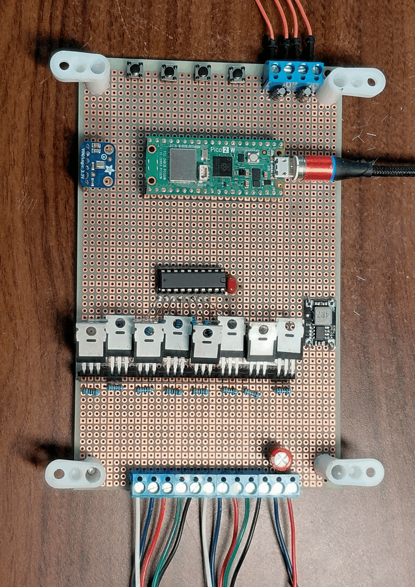

# Cabinet Lighting Controller (RP2350 / Pico 2 W)

A dual-core, perceptually calibrated, 8-channel (dual RGBW) cabinet lighting controller built on the **Raspberry Pi Pico 2 W (RP2350)**.

The firmware partitions real-time hardware kinematics and ultrasonic 20 kHz PWM generation onto **Core 0**, while dedicating **Core 1** to 16 kHz I2S digital audio ingestion and DC-blocked peak telemetry. A 4-band Direct-Form II Transposed IIR filter bank and TinyML (DS-CNN) macro-context classifier are planned for Phases 3 and 4.

---

## Hardware Overview



- **MCU:** Raspberry Pi Pico 2 W (RP2350, Dual ARM Cortex-M33 @ 150 MHz with single-precision FPU & DSP SIMD)
- **LED Drive:** 2× 12V RGBW LED strips (8 channels total) driven at **20 kHz, 7500-tick (6.67 ns/tick)** via a `74AHCT541N` 5V octal buffer and 8× `IRLZ44N` low-side N-channel MOSFETs (with `180 Ω` gate stoppers and `10 kΩ` pull-downs in a 31-pin keyed female header socket bank)
- **Door Sensing:** Left & Right magnetic reed switches (`INPUT_PULLUP` + `0.1 µF` hardware EMI/debounce caps, active-LOW: grounded = closed)
- **Tactile Control:** 4-button satellite pod (`MODE NEXT`, `MODE PREV`, `UP`, `DOWN`, active-LOW)
- **Audio Input:** `INMP441` I2S digital MEMS microphone (16 kHz, 24-bit PCM in 32-bit stereo frames, mono `L/R` tied to `GND`)

### Pinout Reference

| Function | GPIO | Pico Physical Pin | Notes |
| :--- | :--- | :--- | :--- |
| **Strip 1 — White / Blue / Red / Green** | `GP16`, `GP17`, `GP18`, `GP19` | Pins 21, 22, 24, 25 | 20 kHz PWM $\rightarrow$ `74AHCT541N` $\rightarrow$ `IRLZ44N` |
| **Strip 2 — White / Blue / Red / Green** | `GP20`, `GP21`, `GP26`, `GP27` | Pins 26, 27, 31, 32 | 20 kHz PWM $\rightarrow$ `74AHCT541N` $\rightarrow$ `IRLZ44N` |
| **Left / Right Door Reed Switches** | `GP0`, `GP1` | Pins 1, 2 (GND: Pin 3) | `LOW` = Closed, `HIGH` = Open |
| **Buttons: Mode Next / Mode Prev / Brightness Up / Brightness Down** | `GP8`, `GP9`, `GP10`, `GP11` | Pins 11, 12, 14, 15 (GND: Pin 13) | 35 ms debounced falling-edge triggers |
| **INMP441 I2S (`BCLK`, `WS`, `DATA`)** | `GP13`, `GP14`, `GP15` | Pins 17, 19, 20 (`3V3`: Pin 36, `GND`: Pin 18) | `WS` is constrained to `BCLK + 1` |

---

## Firmware Architecture

- **Core 0 (`setup()` / `loop()` @ ~200 Hz):**
  - **Perceptual Color & Kinematics ([`src/door_engine.cpp`](src/door_engine.cpp)):**
    - **Door Open:** 5-second linear cross-fade in empirical gamma-2.4 perceptual space ($\gamma = 2.4$) to calibrated photopic task white (`W: 1.00, R: 1.00, G: 0.90, B: 0.86`), with constant-speed mid-fade reversals.
    - **Normal mode:** Door closed runs a 30-second shortest-arc random hue walk. Thirteen brightness steps span 0–100%, starting at level 4 (9%, with level 0 off). Buttons 1/2 select the next/previous mode; buttons 3/4 adjust brightness.
    - **Debug mode:** Cycles all eight MOSFET channels at 100%, holding each for 1.5 seconds. Hue and door state keep advancing in the background.
  - **Ultrasonic PWM Driver ([`src/led_driver.cpp`](src/led_driver.cpp)):** Maps perceptual lightness through gamma 2.4 into 7500 native ticks at 20 kHz. A RAM-resident wrap ISR uses Q0.16 Sigma-Delta dithering, independent of the control loop.
  - **Input Debouncing ([`src/button_manager.cpp`](src/button_manager.cpp)):** Non-blocking 35 ms state machine across both door contacts and all four satellite buttons. Independent simultaneous presses both apply; same-sample Next+Prev and Up+Down pairs cancel. Held buttons do not repeat.
- **Core 1 (`setup1()` / `loop1()`):**
  - **Real-Time Audio DSP ([`src/audio_dsp.cpp`](src/audio_dsp.cpp)):** I2S FIFO ingestion, DC blocking, peak-hold telemetry, atomic snapshots, and OTA pause/resume (see [`doc/AUDIO_VISION.md`](doc/AUDIO_VISION.md) for the full 4-band IIR biquad, AGC, and DS-CNN TinyML specification).

---

## Building & Flashing (macOS and Linux)

Install Git and Python 3.10+ (macOS: Homebrew or python.org; Debian/Ubuntu: `python3` and `python3-venv`). A C++ compiler is needed for host regression checks (Xcode command line tools or `g++`). The bootstrap can locate a versioned Python on PATH when macOS's system Python is too old.

```bash
python3 scripts/bootstrap.py
source .venv/bin/activate
```

Bootstrap creates a project-local `.venv`, installs pinned PlatformIO, creates `include/secrets.h` only if missing, and builds **both** firmware environments. Re-running preserves credentials. Use `--skip-build` to install only. PlatformIO downloads the pinned community Raspberry Pi platform, core, toolchain and upload tools; first setup needs Internet and several GB of disk space. Python environments follow [PlatformIO's isolated installation model](https://docs.platformio.org/en/latest/core/installation/methods/installer-script.html).

Edit the ignored `include/secrets.h` with your **2.4 GHz** Wi-Fi SSID/password. `OTA_PASSWORD` is optional; empty disables authentication. Build succeeds with placeholder credentials, but Wi-Fi remains disabled.

```bash
pio run -e pico2w-usb -e pico2w-ota

# USB deployment (hold BOOTSEL while plugging in a blank/unresponsive board)
pio run -e pico2w-usb -t upload

# Subsequent deployments over the same LAN: mDNS, then UDP telemetry discovery
pio run -e pico2w-ota -t upload

# Explicit target if discovery is unavailable
pio run -e pico2w-ota -t upload --upload-port 192.168.1.42

# Monitor wireless telemetry, or serial over USB
python3 scripts/udp_monitor.py
pio device monitor --baud 115200
```

If firmware uses a non-empty `OTA_PASSWORD`, set matching `CABINET_OTA_PASSWORD` in your shell before OTA upload. The uploader passes it to espota authentication. Avoid putting passwords in tracked configuration.

USB port selection is automatic on both hosts; use `--upload-port /dev/cu.usbmodem...` (macOS) or `/dev/ttyACM...` (Linux) if multiple boards are present. Linux USB access may require [PlatformIO udev rules](https://docs.platformio.org/en/latest/core/installation/udev-rules.html) and membership in the distribution's serial-device group; bootstrap does not change system permissions. Allow local network access for Python on macOS and LAN traffic for OTA UDP 2040, telemetry UDP 44444, and espota's TCP callback. Both machines and the Pico must be on a LAN without client isolation.

Run `python3 scripts/check_host.py` for PWM, door/input, PCM/envelope, actual OTA transport/main-loop, uploader preflight/authentication, and model-spec regression checks. GitHub Actions runs bootstrap/build and these checks on macOS and Linux. On a board, verify low-end dimming during network traffic, mid-fade reversals, and audio recovery after an abandoned PREP or failed upload; host checks cannot verify electrical timing.

---

## OTA Capacity and Runtime Behavior

Current audio ingestion/telemetry and Phase 2 controls are implemented; audio-reactive rendering is planned. Cabinet installation is unconfirmed. Normal Wi-Fi servicing is non-blocking; a firmware transfer blocks Core 0 controls/rendering and intentionally pauses Core 1 audio. Hardware PWM continues with the last commanded levels. The local [OTA transport](lib/cabinet_ota/readme.md) pauses audio before any update flash access, including direct espota clients. Failed updates resume audio after file cleanup; abandoned PREP expires after 15 seconds.

The unchanged 4 MiB flash layout reserves 1 MiB for LittleFS staging. The host checks the actual upload artifact (including signing overhead) against **983,040 bytes** before PREP: 1 MiB minus 64 KiB for filesystem metadata/OTA commands/headroom. This conservative ceiling does not prove free space; allocation failures still abort on the device. Compressed OTA is not validated and is rejected by this project's preflight. The approximately 3 MiB linker allowance is not the OTA limit.

Pico 2 W and its existing SRAM are fixed; no SD card or native SDK migration is planned. Model weights may reside in flash while the tensor arena, activations, features, stacks and networking share SRAM. Keep the largest useful model that fits measured runtime budgets; do not shrink it merely to fit today's whole-image OTA staging. If a real model exceeds that limit, design a separate model region/update installer and power-loss recovery before changing partitions. That future installer is not implemented here; retain USB recovery.

Peak telemetry samples a DC-blocked envelope with instantaneous attack and a 0.5-second release, not an exact one-second maximum. `[HEALTH]` adds build identity, uptime, report sequence, maximum loop interval, DSP/storage/OTA state, sample count and reconnect count. See [bench validation](doc/bench_validation.md) for interpretation and pending checks.

## VS Code

Open the project folder in Visual Studio Code. The `.vscode` folder provides shared settings, extension recommendations, and tasks. Recommended extensions are PlatformIO IDE, clangd, Python, and YAML. clangd provides C++ navigation/completion from PlatformIO's generated `compile_commands.json`; Microsoft's competing IntelliSense engine is disabled in this workspace. Python uses `.venv`. Cursor can also use the shared settings and tasks, although its marketplace did not offer PlatformIO IDE during setup.

Run **Terminal → Run Task → Cabinet: Bootstrap** on a fresh clone. Bootstrap builds both environments and generates the local C++ compilation database. **Cmd+Shift+B** (macOS) or **Ctrl+Shift+B** (Linux) builds both firmware environments. Run **Cabinet: Refresh C++ index** after changing source files or compiler configuration. Other `Cabinet:` tasks provide host regression checks, OTA/USB upload, wireless telemetry, and USB serial monitoring. These tasks invoke the pinned project-local PlatformIO directly. New integrated terminals also put `.venv/bin` on PATH; PlatformIO's own toolbar manages its Core independently through the extension's standard installation.

Project tasks, activated terminals and CI use Core **6.1.18** from `requirements-dev.txt`. The extension may manage a different Core; the local 6.2.0 notice is understood and is not a compiler diagnostic. For reproducible builds/uploads use `.venv/bin/pio` or the `Cabinet:` tasks; check `command -v pio` and `pio --version` in a terminal rather than assuming the toolbar shares it. Do not uninstall other Core installations to silence the notice.

The settings and tasks use workspace-relative paths on macOS and Linux. Install a clangd executable (Xcode command line tools on this Mac; your distribution's `clangd` package on Linux), or use the clangd extension's server download prompt. The generated compilation database contains host-specific compiler paths and remains ignored by Git. Hardware breakpoints require a separate SWD probe; USB and OTA tasks provide flashing and telemetry.

Use **File → Open Folder** to open this checkout; a separate workspace file is not needed.

---

## Project Documentation

- **[`AGENTS.md`](AGENTS.md):** Hardware invariants, dual-core safety rules, and agentic workflow protocol.
- **[`HANDOFF.md`](HANDOFF.md):** Live project status snapshot and immediate next steps.
- **[`doc/HARDWARE_AND_BOM.md`](doc/HARDWARE_AND_BOM.md):** Complete Bill of Materials (BOM), perfboard spatial layout, socketizing guide, star-ground topology, and pin-by-pin wiring tables.
- **[`doc/AUDIO_VISION.md`](doc/AUDIO_VISION.md):** Authoritative specification for the Core 1 4-band `DF2T` IIR filter bank, adaptive noise floor & AGC, math-rock envelope followers, 8-channel spatial choreography, and 4-class DS-CNN TinyML classifier.

- **[Bench validation](doc/bench_validation.md):** Ordered electrical checks, OTA recovery/password tests, and finite telemetry soak.
