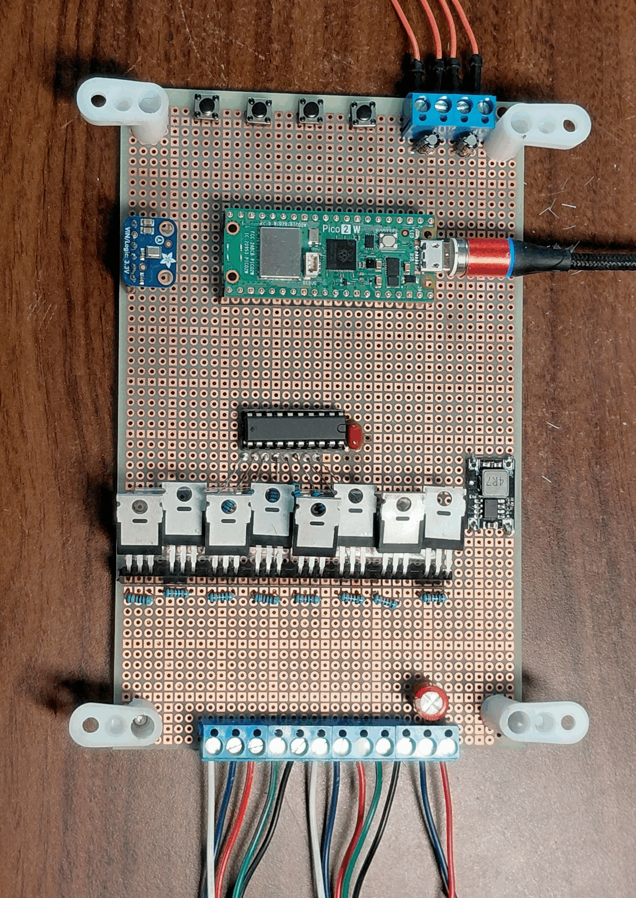
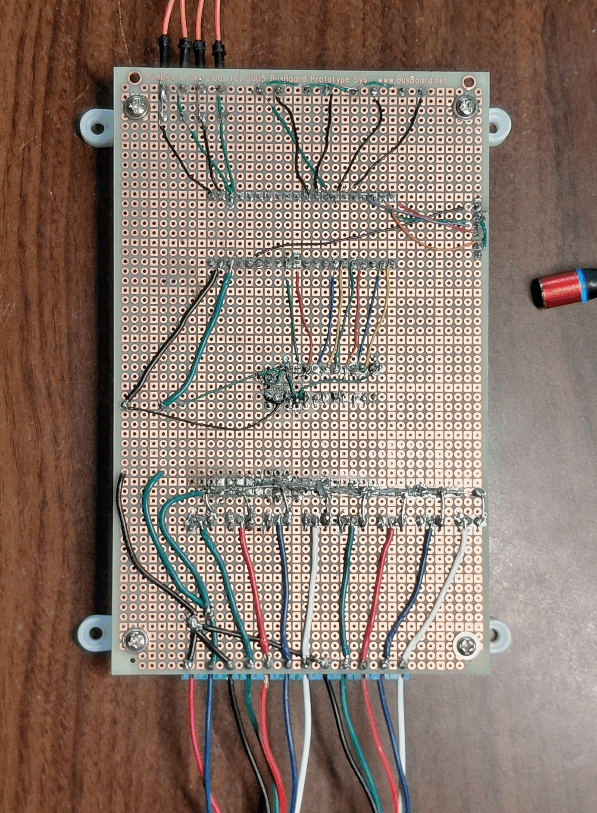

# Hardware Architecture, Perfboard Layout & Bill of Materials

This document serves as the permanent hardware reference for the **Cabinet Lighting Controller**, synthesized from the build logs, schematic guides, and bench bring-up records.

PWM uses 20 kHz, 7500 native ticks (6.67 ns/tick), `PWM_PEDESTAL_TICKS = 20` and `PWM_MIN_PULSE_TICKS = 30`. A RAM-resident hardware wrap ISR performs Sigma-Delta dithering between off/30 ticks below the matched floor and adjacent integer ticks above it.

---

## 1. Complete Bill of Materials (BOM)

### A. Core Microcontroller, Logic & Audio ICs

| Qty | Component / Part Number | Package / Rating | Purpose & Notes |
| :---: | :--- | :--- | :--- |
| **1** | **Raspberry Pi Pico 2 W** (`RP2350A` + Infineon `CYW43439`) | 40-pin DIP form factor (`51 × 21 mm`), Micro-USB, `3.3V` logic | Dual ARM Cortex-M33 @ 150 MHz (single-precision FPU + DSP SIMD), 520 KB SRAM, 4 MB Flash, 2.4 GHz 802.11n Wi-Fi (OTA updates & UDP audio streaming). |
| **1** | **SN74AHCT541N** (Texas Instruments / Nexperia) | **20-Pin PDIP** (`0.300"` / `7.62 mm` narrow row pitch, `0.1"` pin pitch) | Octal buffer/line driver with 3-state outputs. Powered at `5.0V` ($V_{CC}$) with TTL input thresholds ($V_{IH} = 2.0\text{V}$). Shifts 8× `3.3V` Pico PWM signals to `5.0V` push-pull gate drive ($\pm 8\text{ mA}$) to saturate the MOSFETs and isolate the RP2350 GPIO rails from the `~1700 pF` per-FET gate capacitance. *(Must be `N` PDIP-20 suffix and `AHCT` TTL-threshold variant).* |
| **1** | **INMP441 I2S Digital MEMS Microphone Breakout** | 6-pin breakout (`3V`, `GND`, `CLK`, `DOUT`, `LRCL`, `SEL`) | Omnidirectional bottom-ported digital MEMS microphone (`1.8V–3.3V`, max `3.6V`, `~1.4 mA`). Streams 24-bit PCM in 32-bit I2S frames at `16 kHz` (`BCLK = 1.024 MHz`). Mounted in the quiet logic zone with `SEL` (`L/R`) bridged to `GND` for Mono/Left channel. |

### B. Power Stage & Voltage Regulation

| Qty | Component / Part Number | Package / Rating | Purpose & Notes |
| :---: | :--- | :--- | :--- |
| **8** | **Infineon IRLZ44NPBF** | **TO-220AB** through-hole (`55V`, `47A`, $R_{DS(\text{on})} \approx 22\text{–}28\text{ m}\Omega$ @ $V_{GS}=5\text{V}$) | Logic-level N-channel power MOSFETs ($V_{GS(\text{th})} = 1.0\text{–}2.0\text{V}$, $C_{iss} \approx 1700\text{ pF}$). Low-side cathode switches for the 8 RGBW channels (`W1, B1, R1, G1, W2, B2, R2, G2`). At `1.0–1.5A` per channel and $V_{GS}=5.0\text{V}$, each dissipates `< 70 mW` and requires no heatsink. |
| **1** | **Micro Synchronous Step-Down (Buck) Converter (`4R7` / Mini-360 style)** | 4-pad PCB module (`IN+`, `IN-`, `VO+`, `OUT-`), molded `4.7 µH` (`4R7`) inductor, `2A` cont. / `3A` peak | Steps incoming `12V DC` (`~85–90%` efficiency) down to fixed `5.0V DC` (verified `5.0V` on bench) to power Pico `VSYS` (Pin 39) and `74AHCT541` $V_{CC}$ (Pin 20). Input and output `GND` pads share a solid internal copper plane. |
| **1** | **Main Cabinet 12V Power Supply** | `12V DC`, `150W` (`12.5A`) | Primary power supply for final cabinet installation (drives up to `6A–10A` total when all 8 RGBW channels are at full brightness). |
| **1** | **Bench Testing 12V Wall Adapter** | `12V DC`, `1.0A–2.0A` (`12W–24W`), center-positive | Current-limited supply used on the bench with two short 1-segment test strips (`~310 mA` total peak draw: `160 mA` LEDs + `150 mA` logic) to limit fault energy during testing. |

### C. Passive Components (Resistors & Capacitors)

| Qty | Component / Value | Package / Rating | Purpose & Notes |
| :---: | :--- | :--- | :--- |
| **8** | **180 Ω Series Gate Resistors** *(spec range: `100–220 Ω`)* | `1/4W` through-hole axial metal film | Placed inline between `74AHCT541` outputs (Pins 18–11) and MOSFET Gate pins (Pin 1) to dampen high-frequency gate ringing and limit nanosecond switching inrush current. |
| **8** | **10 kΩ Gate Pull-Down Resistors** | `1/4W` through-hole axial metal film (`±5%`) | Soldered directly between each MOSFET socket's Gate (Pin 1) and Source/GND (Pin 3). Clamps gates to `0V` ($\tau = R \times C \approx 17\ \mu\text{s}$) when the Pico or buffer is in reset/tri-state (`~8 kΩ` measured in-circuit). Delivers `4.91V` to the gate when driven HIGH through the `180 Ω` series stopper. |
| **1** | **1000 µF Bulk Electrolytic Capacitor** *(spec range: `470–1000 µF`)* | Radial aluminum electrolytic, rated **`≥ 25V` or `35V`**, low-ESR | Placed directly across the incoming `+12V IN` and `GND IN` screw terminal pads. Acts as a local charge reservoir to absorb inductive flyback spikes and prevent `12V` rail sag during `20 kHz` 8-channel PWM switching. |
| **1** | **0.1 µF (`100 nF`, code `104J`) Bypass Capacitor** | Red dipped metallized polyester film capacitor (`104J` = `0.1 µF ±5%`, low ESL, scavenged from `C9` of a Lepy `LP-2020A+`) | High-frequency local decoupling capacitor soldered diagonally across **Pin 20 ($V_{CC}$)** and **Pin 10 (`GND`)** on the underside of the `74AHCT541` DIP-20 socket. Supplies nanosecond gate-drive current spikes locally. |
| **2** | **0.1 µF (`100 nF`) Door Switch Debounce Capacitors** | Small polarized electrolytic barrel capacitors (`0.1 µF`, `50V`, date code `1908`) | Hardware RC low-pass EMI/debounce filters placed across each reed switch input (`GP0` and `GP1`) to quiet Logic `GND` (Pin 3) to snub RF/PWM noise picked up by long cabinet wire runs. *(Positive `+` long lead to GPIO pin; negative `–` striped lead to Pin 3 `GND`).* |

### D. Sockets, Connectors & Terminal Blocks

| Qty | Component / Part Number | Package / Rating | Purpose & Notes |
| :---: | :--- | :--- | :--- |
| **2** | **1×20-Pin Female Socket Header Strips** | `0.1"` (`2.54 mm`) pitch, through-hole | Spaced `0.7"` (`17.78 mm` / 7 perfboard holes) apart to socket the Raspberry Pi Pico 2 W. |
| **1** | **20-Pin Narrow IC DIP Socket** | `0.1"` (`2.54 mm`) pitch, **`0.300"` (`7.62 mm`) row spacing**, dual-wipe solder tail | Sockets the `SN74AHCT541N` octal buffer IC. |
| **1** | **1×40-Pin Breakaway Female Header Strip** *(31 pins active)* | `0.1"` (`2.54 mm`) pitch, stamped leaf-spring contacts (`2A–3A` rated per pin) | Continuous socket bank for all **8× `IRLZ44N` TO-220 MOSFETs** (`8 × 3 pins + 7 × 1 empty spacer pin = 31 pins`, with pins 32–40 spare/trimmed). |
| **1** | **2-Position Screw Terminal Block** | `5.0 mm` / `5.08 mm` pitch, elevator-cage style, **`15A` (`300V`) rated** | Main `12V DC` power entry (`[+12V IN]`, `[GND IN]`). |
| **2** | **5-Position Screw Terminal Blocks** | `5.0 mm` / `5.08 mm` pitch, elevator-cage style, **`15A` (`300V`) rated** | Dedicated output blocks for **Strip 1** (`[+12V] [W1-] [B1-] [R1-] [G1-]`) and **Strip 2** (`[+12V] [W2-] [B2-] [R2-] [G2-]`). Rated for the combined `6A–10A` common `+12V` anode current. |
| **1** | **Multi-Position Logic Screw Terminal Block** (`6-` to `8-position`, or `3-pin` + `4-pin`) | `5.0 mm` / `5.08 mm` (or `3.5 mm`) pitch | Connects off-board Left & Right Door Reed Switches, 4 Satellite Pushbuttons, and quiet Logic `GND` returns. |

### E. LED Strips, Switches, Board, Wire & Mounting Hardware

| Qty | Component / Description | Specification / Rating | Purpose & Notes |
| :---: | :--- | :--- | :--- |
| **2** | **12V Analog RGBW (WRGB) LED Strips** *(plus two 1-segment 3-LED test cuts)* | `12V DC` common-anode (`+12V`, `W`, `B`, `R`, `G` 5-pad layout), 3-LED series cut segments (`~20 mA` per color per segment; `~1.0–1.5A` per channel full strip) | Strip 1 (Left) and Strip 2 (Right) cabinet illumination. Purely resistive/diode loads. |
| **2** | **Magnetic Door Reed Switches** (e.g., EPLZON / Sodial / Adafruit PID 375) | Normally Closed (`NC` / Form B: magnet near = switch closed to `GND` = `LOW`; door open = magnet away = switch open = pulled `HIGH`) | Discrete Left Door (`GP0`) and Right Door (`GP1`) sensing. |
| **4** | **Momentary Tactile Pushbuttons** | SPST Normally Open (`NO`) momentary switches | 4-button satellite pod (`Mode Next`, `Mode Prev`, `Brightness Up`, `Brightness Down`), active-LOW. |
| **1** | **Large Double-Sided FR4 Perfboard** | Plated through-hole (`PTH`), `0.1"` (`2.54 mm`) grid, `~9 × 15 cm` or `10 × 16 cm` | Main circuit board substrate. Corner mounting holes enlarged with a `1/8"` (`3.2 mm`) HSS bit to fit `M3` hardware. |
| **4** | **Nylon L-Shaped PCB Mounting Brackets ("Arcade Feet" / JAMMA Feet)** | `90°` insulated nylon brackets (`~20 mm` standoff height) + **4× `M3 × 6 mm` machine screws/nuts/washers** + **4× `#4 × 1/2"` or `#6 × 1/2"` pan-head wood screws** | Fastens the perfboard corners underneath the `3/4"` cabinet shelf (pre-drilled `3/8"` deep with a drill stop) with outward-facing flanges and full underside clearance. |
| — | **Heavy Solid Bus Wire** | **`18 AWG` or `20 AWG` bare solid tinned copper wire** | High-current `MOSFET Source (Pin 3)` bus to Star Ground Hub, and `+12V` main anode trunk from `+12V IN` to bulk cap, buck `IN+`, and both strip `+12V` terminals. |
| — | **Medium Hookup Wire** | **`20–22 AWG` insulated wire** (MOSFET Drain-to-terminal runs) & **`22–24 AWG` insulated wire** (`5V` / `GND` power feed between Buck converter and Pico `VSYS`/`GND`) | Prevents voltage sag during `200–300+ mA` Pico 2 W Wi-Fi transmission bursts. |
| — | **Logic Point-to-Point Wire** | **`30 AWG` silver-plated solid copper Kynar (PVDF) wire-wrap wire** (safe to `200–250 mA` DC) | Used for all `3.3V`/`5V` logic signal runs: Pico GPIOs to `74AHCT541`, buffer outputs to `180 Ω` resistors, `OE1`/`OE2` ground chain, `INMP441` I2S lines, and switch/button sense lines. |
| **1** | **Polyolefin Heat-Shrink Tubing Strip (Un-shrunk Ribbon)** | Slit lengthwise and flattened into a ribbon | Slid underneath the 8 bare topside `180 Ω` resistor leads where they cross over the topside solder mounds of the underside heavy ground bus. |

---

## 2. Final Board Layout & Physical Construction





### A. Three-Zone Spatial Partitioning (As-Built Bench Orientation — USB Facing Down)

To prevent `6A–10A` `20 kHz` PWM switching currents from inducing ground bounce or EMI in the `3.3V` MCU or I2S audio clock, the perfboard is divided into three physical zones (described below matching the top-view bench photo with the Pico's USB port facing **down**):

1. **Right Side — Quiet Logic, Sensor & User Input Zone (Pico Pins 1–20 Side):**
   - **Raspberry Pi Pico 2 W** seated in dual `1×20` female sockets with its Micro-USB port facing the bottom edge (equipped with a magnetic USB breakaway tip). In this orientation, **Pins 1–20** run along the **right** header column (bottom-to-top) and **Pins 21–40** run along the **left** header column (top-to-bottom).
   - **Right Edge Inputs:**
     - **Bottom-Right:** 3-position blue screw terminal block for the Left & Right Door Reed Switches (`GP0`, `GP1`, and `Pin 3 GND`), with the **2× `0.1 µF` polarized barrel debounce capacitors** mounted immediately behind the terminal (tested on the bench via jumper wires to the yellow mini-breadboard).
     - **Mid/Upper-Right Edge:** The **4 momentary tactile pushbuttons** (`MODE NEXT`, `MODE PREV`, `UP`, `DOWN`) mounted in a vertical column along the right edge of the perfboard for direct thumb/finger access.
   - **Top-Right (Above Pico):** The **I2S Digital MEMS Microphone breakout** (blue PCB) mounted in the quiet logic corner away from the power stage.
2. **Center — Level-Shifting, Gate Drive & 5V Regulation Zone (Pico Pins 21–40 Side):**
   - Directly to the left of the Pico's PWM header (`Pins 21–32`) sits the **`SN74AHCT541N` in its 20-pin narrow DIP socket**, with the red dipped **`104J` (`0.1 µF`) film bypass capacitor** mounted right at the bottom of the socket across $V_{CC}$ and `GND`.
   - Along the bottom edge between the Pico and the MOSFET bank sits the **`4R7` synchronous `5V` buck converter module**.
3. **Left Side — High-Current MOSFET Bank & 12V Terminal Strip:**
   - Left of the `74AHCT541N` runs the vertical **`1×40` female header socket strip** (31 active pins) hosting all **8× `IRLZ44N` TO-220 MOSFETs** in a single straight column.
   - Immediately to the left of the MOSFET sockets sit the **8× `180 Ω` series gate resistors** and **8× `10 kΩ` gate-to-source pull-downs** (with the flattened black heat-shrink insulation ribbon underneath the topside resistor leads).
   - Along the far **left edge** sits the continuous `15A` blue screw terminal bank (`5-pos` Strip 1 + `5-pos` Strip 2 + `2-pos` `12V DC Input` at the bottom-left), with the radial **bulk electrolytic capacitor** tucked immediately beside the bottom-left `12V IN` terminal.
   - **Corner Mounting:** All four corners feature **white nylon L-shaped mounting brackets ("arcade feet")** secured with `M3` screws and nuts.

```text
+---------------------------------------------------------------------------------------------------+
| [Nylon L-Foot]                                        [I2S Mic Breakout]           [Nylon L-Foot] |
|                                                       (GP13/14/15, 3V3)                           |
|  +------------------+   +-------------------------+                                      +-----+  |
|  | Strip 1 Terminal |   | 8x IRLZ44N MOSFET Bank  |   +------------------+   +--------+  | Btn |  |
|  | (5-Pos 15A)      |<--| (1x40 Socket, 31 Pins)  |   | 74AHCT541N       |   | Pico   |  |  4  |  |
|  | [+12V][W][B][R][G]   | + 8x 180R Gate Stoppers |<--| (DIP-20 Socket)  |<--| 2 W    |  | Btn |  |
|  +------------------+   | + 8x 10k Pull-Downs     |   |                  |   |        |  |  3  |  |
|  | Strip 2 Terminal |   | + Heat-Shrink Insulator |   | + Red 104J (0.1u)|   | Pins   |  | Btn |  |
|  | (5-Pos 15A)      |<--| + 18 AWG Bare Source Bus|   |   Film Bypass Cap|   | 21..40 |  |  2  |  |
|  | [+12V][W][B][R][G]   +------------+------------+   +------------------+   | (Left) |  | Btn |  |
|  +------------------+                |                                       |        |  |  1  |  |
|  | 12V DC Input     |                v                                       | Pins   |  +-----+  |
|  | (2-Pos 15A)      |<---[Star Ground Hub & +12V Trunk]--->[4R7 5V Buck]---->| 1..20  |  +-----+  |
|  | + Bulk Cap       |                                      (Bottom Edge)     | (Right)|<-|Reeds|  |
|  +------------------+                                                        +---+----+  |3-Pos|  |
| [Nylon L-Foot]                                                        [USB]      |       +-----+  |
|                                                                                  v   (2x 0.1uF)   |
+---------------------------------------------------------------------------------------------------+
```

### B. MOSFET Socketizing Strategy (`1×40` Female Header Strip)

Because TO-220 leads have a flat rectangular cross-section (`~0.5 mm × 0.9 mm` to `0.75 mm × 1.25 mm`), standard IC DIP sockets cannot be used. Instead, a single continuous **`1×40` `0.1"` female header strip** sockets all 8 MOSFETs:

1. **31-Pin Span with 1-Hole Air Gaps:** Each `IRLZ44N` uses 3 pins (`1 = Gate`, `2 = Drain`, `3 = Source`) and every 4th pin is skipped as a `0.1"` (`2.54 mm`) spacer (`(8 × 3) + (7 × 1) = 31 pins`; pins 32–40 are cut off or left unpopulated). This keeps the live metal TO-220 Drain tabs physically separated so adjacent channels cannot short if nudged.
2. **Pre-Soldering Header Prep (Clipped Tails & Keyed Holes):**
   - **Underside:** The solder tails of the **7 skipped spacer pins (`Pins 4, 8, 12, 16, 20, 24, 28`)** are clipped flush before soldering so the heavy underside ground bus and gate traces can pass cleanly without bridging.
   - **Topside Keying:** A tiny piece of solid wire, toothpick sliver, or glue dab is placed into the top openings of holes **`4, 8, 12, 16, 20, 24, 28`** to physically key the socket and prevent plugging a MOSFET in offset by 1 pin (which would short Drain to Gate).
3. **90° Axial Lead Twist:** Before seating each `IRLZ44N`, the lower `4–5 mm` tip of each of the three flat TO-220 legs is given a gentle **`90°` axial twist** with needle-nose pliers so the narrow edge enters the female header's internal "tuning-fork" leaf spring contacts cleanly without stretching or deforming them.
4. **Board-Side Pull-Downs:** All 8× `10 kΩ` gate pull-down resistors and 8× `180 Ω` series gate resistors are soldered directly to the **underside socket pads** (`Pin 1` to `Pin 3` for `10 kΩ`), ensuring the gate line stays clamped to `GND` even if a MOSFET is unseated.

### C. Power Bus & Star-Ground Topology

1. **The Star Ground Center (`12V GND IN` Terminal Pad):**
   - Located directly beneath the negative (`–`) solder tail of the 2-position `15A` `12V DC Input` screw terminal.
   - **Zero-Length Capacitor & Buck Tie:** The `1000 µF` bulk electrolytic capacitor's negative (`–`) lead and the `5V` Buck Converter's `IN-` (`GND`) pad are placed immediately adjacent to the `12V GND IN` pad, sharing a direct, near-zero-length solder bridge at the Star Center.
   - **Path 1 — Noisy High-Current Return (`6A–10A`):** A heavy **`18–20 AWG` bare solid tinned copper bus wire** runs directly from the Star Ground Hub along all 8 MOSFET `Source` pins (`Header Pins 3, 7, 11, 15, 19, 23, 27, 31`). High-current PWM return spikes never enter the logic ground plane.
   - **Path 2 — Quiet Logic Ground Feed:** Because the Buck Converter's `IN-` and `OUT-` share an internal solid copper plane, the clean logic ground branches off **`Buck OUT- (GND)`** using **`22–24 AWG` wire** to avoid ground loops. It routes directly to **`74AHCT541` Pin 10 (`GND`)** (chained to `Pin 1` and `Pin 19`) and **Pico Pin 38 (`GND`)**. Quiet peripheral returns use dedicated Pico ground pins (`Pin 3` for reed switches, `Pin 13` for buttons, `Pin 18` for the `INMP441` mic).
2. **`+12V` High-Current Anode Trunk:**
   - A heavy **`18–20 AWG` bare solid copper wire** links `+12V IN` $\rightarrow$ `Bulk Capacitor (+)` $\rightarrow$ `Buck Converter IN+` $\rightarrow$ `Strip 1 [+12V]` terminal $\rightarrow$ `Strip 2 [+12V]` terminal.
3. **`+5V` Logic Power Chain:**
   - Routed with **`22–24 AWG` hookup wire** (not `30 AWG` Kynar, to prevent voltage sag during `200–300 mA` Wi-Fi bursts) between **`Buck Converter VO+ (+5V)`**, **Pico Pin 39 (`VSYS`)**, and **`74AHCT541` Pin 20 ($V_{CC}$)**. Feeding `5V` into `VSYS` Pin 39 utilizes the Pico's onboard protection diode so USB can be safely plugged into `VBUS` Pin 40 while `12V` power is live.
4. **`+3.3V` Clean Audio/Sensor Rail:**
   - **Pico Pin 36 (`3V3_OUT`)** feeds **`INMP441` `3V` (`VDD`)** directly via `30 AWG` Kynar wire, and provides internal pull-ups (`INPUT_PULLUP`) for the switches and buttons.

---

## 3. Exact Pin-by-Pin Wiring & Schematic Reference

### A. Complete `74AHCT541N` DIP-20 Pinout Mapping (Pins 1 to 20)

> **Physical Note on Input/Output Row Shift:** The `74AHCT541` has a flow-through layout (inputs on left `Pins 2–9`, outputs on right `Pins 18–11`), but because `Pin 1` ($\overline{OE1}$) is at the top-left while `Pin 20` ($V_{CC}$) and `Pin 19` ($\overline{OE2}$) occupy the top two pins on the right, **each output pin (`Y0–Y7`) is shifted down by one physical row relative to its opposite pin** (`A0` on Pin 2 is across from Pin 19, while its output `Y0` is on Pin 18 across from Pin 3).

```text
                          74AHCT541N (DIP-20, Top View)
                                   ┌───U───┐
          Logic GND <─── /OE1 ────1│       │20──── VCC (+5V from Buck + 0.1uF Cap Lead 1)
   Pico GP16 (Pin 21) ──> A0  ────2│       │19──── /OE2 ───> Chained to Pin 1 & Pin 10 (GND)
   Pico GP17 (Pin 22) ──> A1  ────3│       │18──── Y0   ───> 180Ω ──> FET 1 Gate (W1, Hdr Pin 1)
   Pico GP18 (Pin 24) ──> A2  ────4│       │17──── Y1   ───> 180Ω ──> FET 2 Gate (B1, Hdr Pin 5)
   Pico GP19 (Pin 25) ──> A3  ────5│       │16──── Y2   ───> 180Ω ──> FET 3 Gate (R1, Hdr Pin 9)
   Pico GP20 (Pin 26) ──> A4  ────6│       │15──── Y3   ───> 180Ω ──> FET 4 Gate (G1, Hdr Pin 13)
   Pico GP21 (Pin 27) ──> A5  ────7│       │14──── Y4   ───> 180Ω ──> FET 5 Gate (W2, Hdr Pin 17)
   Pico GP26 (Pin 31) ──> A6  ────8│       │13──── Y5   ───> 180Ω ──> FET 6 Gate (B2, Hdr Pin 21)
   Pico GP27 (Pin 32) ──> A7  ────9│       │12──── Y6   ───> 180Ω ──> FET 7 Gate (R2, Hdr Pin 25)
  (0.1uF Cap Lead 2) ───> GND ───10│       │11──── Y7   ───> 180Ω ──> FET 8 Gate (G2, Hdr Pin 29)
                                   └───────┘
```

| DIP-20 Pin # | Signal Name | Side / Direction | Connected To | LED Channel / Function |
| :---: | :--- | :--- | :--- | :--- |
| **Pin 1** | $\overline{OE1}$ | Left (Control In) | Chained to **Pin 10 (`GND`)** & **Pin 19 ($\overline{OE2}$)** | Active-LOW Output Enable 1 (permanently enabled) |
| **Pin 2** | `A0` (`1A1`) | Left (3.3V Input) | **Pico Physical Pin 21 (`GP16`)** (PWM Slice 0A) | **Ch 0 — Strip 1 White (`W1`)** |
| **Pin 3** | `A1` (`1A2`) | Left (3.3V Input) | **Pico Physical Pin 22 (`GP17`)** (PWM Slice 0B) | **Ch 1 — Strip 1 Blue (`B1`)** |
| **Pin 4** | `A2` (`1A3`) | Left (3.3V Input) | **Pico Physical Pin 24 (`GP18`)** (PWM Slice 1A) | **Ch 2 — Strip 1 Red (`R1`)** |
| **Pin 5** | `A3` (`1A4`) | Left (3.3V Input) | **Pico Physical Pin 25 (`GP19`)** (PWM Slice 1B) | **Ch 3 — Strip 1 Green (`G1`)** |
| **Pin 6** | `A4` (`1A5`) | Left (3.3V Input) | **Pico Physical Pin 26 (`GP20`)** (PWM Slice 2A) | **Ch 4 — Strip 2 White (`W2`)** |
| **Pin 7** | `A5` (`1A6`) | Left (3.3V Input) | **Pico Physical Pin 27 (`GP21`)** (PWM Slice 2B) | **Ch 5 — Strip 2 Blue (`B2`)** |
| **Pin 8** | `A6` (`1A7`) | Left (3.3V Input) | **Pico Physical Pin 31 (`GP26`)** (PWM Slice 5A) | **Ch 6 — Strip 2 Red (`R2`)** |
| **Pin 9** | `A7` (`1A8`) | Left (3.3V Input) | **Pico Physical Pin 32 (`GP27`)** (PWM Slice 5B) | **Ch 7 — Strip 2 Green (`G2`)** |
| **Pin 10** | `GND` | Left (Bottom Corner) | **Buck `OUT- (GND)`**, **Pico `GND` (Pin 38)**, **Pin 1**, **Pin 19**, and **Lead 2 of `0.1 µF` (`104J`) Bypass Cap** | IC Ground Reference (`0.1 µF` cap sits in parallel across Pins 10 & 20) |
| **Pin 11** | `Y7` (`1Y8`) | Right (5.0V Output) | `180 Ω` resistor $\rightarrow$ **MOSFET 8 Gate** (`1×40` Pin 29) | Drives **Strip 2 Green (`G2-`)** |
| **Pin 12** | `Y6` (`1Y7`) | Right (5.0V Output) | `180 Ω` resistor $\rightarrow$ **MOSFET 7 Gate** (`1×40` Pin 25) | Drives **Strip 2 Red (`R2-`)** |
| **Pin 13** | `Y5` (`1Y6`) | Right (5.0V Output) | `180 Ω` resistor $\rightarrow$ **MOSFET 6 Gate** (`1×40` Pin 21) | Drives **Strip 2 Blue (`B2-`)** |
| **Pin 14** | `Y4` (`1Y5`) | Right (5.0V Output) | `180 Ω` resistor $\rightarrow$ **MOSFET 5 Gate** (`1×40` Pin 17) | Drives **Strip 2 White (`W2-`)** |
| **Pin 15** | `Y3` (`1Y4`) | Right (5.0V Output) | `180 Ω` resistor $\rightarrow$ **MOSFET 4 Gate** (`1×40` Pin 13) | Drives **Strip 1 Green (`G1-`)** |
| **Pin 16** | `Y2` (`1Y3`) | Right (5.0V Output) | `180 Ω` resistor $\rightarrow$ **MOSFET 3 Gate** (`1×40` Pin 9) | Drives **Strip 1 Red (`R1-`)** |
| **Pin 17** | `Y1` (`1Y2`) | Right (5.0V Output) | `180 Ω` resistor $\rightarrow$ **MOSFET 2 Gate** (`1×40` Pin 5) | Drives **Strip 1 Blue (`B1-`)** |
| **Pin 18** | `Y0` (`1Y1`) | Right (5.0V Output) | `180 Ω` resistor $\rightarrow$ **MOSFET 1 Gate** (`1×40` Pin 1) | Drives **Strip 1 White (`W1-`)** |
| **Pin 19** | $\overline{OE2}$ | Right (Control In) | Chained to **Pin 1 ($\overline{OE1}$)** and **Pin 10 (`GND`)** | Active-LOW Output Enable 2 (`Buck GND -> Pin 1 -> Pin 19 -> Pin 10`) |
| **Pin 20** | $V_{CC}$ | Right (Top Corner) | **Buck `VO+ (+5V)`**, **Pico `VSYS` (Pin 39)**, and **Lead 1 of `0.1 µF` (`104J`) Bypass Cap** | `+5.0V` Power Supply Input (`0.1 µF` cap spans diagonally underneath from Pin 20 to Pin 10) |

---

### B. Complete Raspberry Pi Pico 2 W Physical Pin & GPIO Table (Pins 1 to 40)

*(Internal RP2350 pins `GP23` [OP_MODE], `GP24` [VBUS_SENSE/Wi-Fi SPI], `GP25` [Wi-Fi CS/LED], and `GP29` [VSYS/3 ADC] are strictly avoided).*

| Left Header Pin # | GPIO / Name | Connected To in Build | Right Header Pin # | GPIO / Name | Connected To in Build |
| :---: | :--- | :--- | :---: | :--- | :--- |
| **Pin 1** | `GP0` | **Left Door Reed Switch** (`PIN_DOOR_LEFT = 0`, `INPUT_PULLUP` + `0.1 µF` cap to Pin 3) | **Pin 40** | `VBUS` | Unconnected (USB `5V` when plugged into PC; isolated from `VSYS` by onboard diode) |
| **Pin 2** | `GP1` | **Right Door Reed Switch** (`PIN_DOOR_RIGHT = 1`, `INPUT_PULLUP` + `0.1 µF` cap to Pin 3) | **Pin 39** | `VSYS` | **Buck Converter `+5.0V OUT`** (`22–24 AWG`, chained with `74AHCT541` Pin 20) |
| **Pin 3** | `GND` | **Reed Switch Common `GND`** (and `–` leads of the two `0.1 µF` debounce caps) | **Pin 38** | `GND` | **Primary Logic `GND` Tie-In** (`22–24 AWG` from Buck `OUT-` / `74AHCT541` Pin 10) |
| **Pin 4** | `GP2` | *Unused / Spare* | **Pin 37** | `3V3_EN` | *Unconnected* (Pulled high internally to `VSYS` to enable `3.3V` regulator) |
| **Pin 5** | `GP3` | *Unused / Spare* | **Pin 36** | `3V3(OUT)` | **INMP441 Mic `3V` (`VDD`)** (Clean `3.3V` supply; never feed `5V`) |
| **Pin 6** | `GP4` | *Unused / Spare* | **Pin 35** | `ADC_VREF` | *Unused / Spare* |
| **Pin 7** | `GP5` | *Unused / Spare* | **Pin 34** | `GP28` / `ADC2` | *Unused / Spare* |
| **Pin 8** | `GND` | *Quiet Logic Ground (Spare)* | **Pin 33** | `AGND` | *Unused / Analog Ground* |
| **Pin 9** | `GP6` | *Unused / Spare* | **Pin 32** | `GP27` (PWM 5B) | **`74AHCT541` Pin 9 (`A7`)** $\rightarrow$ **Strip 2 Green (`G2`)** (`PIN_PWM_G2 = 27`) |
| **Pin 10** | `GP7` | *Unused / Spare* | **Pin 31** | `GP26` (PWM 5A) | **`74AHCT541` Pin 8 (`A6`)** $\rightarrow$ **Strip 2 Red (`R2`)** (`PIN_PWM_R2 = 26`) |
| **Pin 11** | `GP8` | **Button 1: Mode Next** (`PIN_BTN_MODE_NEXT = 8`, `INPUT_PULLUP`) | **Pin 30** | `RUN` | *Skipped / Do Not Use* (Hardware Reset line) |
| **Pin 12** | `GP9` | **Button 2: Mode Prev** (`PIN_BTN_MODE_PREV = 9`, `INPUT_PULLUP`) | **Pin 29** | `GP22` | *Skipped / Spare GPIO* |
| **Pin 13** | `GND` | **Shared Common `GND` Return for all 4 Pushbuttons** | **Pin 28** | `GND` | *Skipped* (Quiet Logic `GND` pad) |
| **Pin 14** | `GP10` | **Button 3: Brightness Up** (`PIN_BTN_BRIGHT_UP = 10`, `INPUT_PULLUP`) | **Pin 27** | `GP21` (PWM 2B) | **`74AHCT541` Pin 7 (`A5`)** $\rightarrow$ **Strip 2 Blue (`B2`)** (`PIN_PWM_B2 = 21`) |
| **Pin 15** | `GP11` | **Button 4: Brightness Down** (`PIN_BTN_BRIGHT_DOWN = 11`, `INPUT_PULLUP`) | **Pin 26** | `GP20` (PWM 2A) | **`74AHCT541` Pin 6 (`A4`)** $\rightarrow$ **Strip 2 White (`W2`)** (`PIN_PWM_W2 = 20`) |
| **Pin 16** | `GP12` | *Unused / Spare* | **Pin 25** | `GP19` (PWM 1B) | **`74AHCT541` Pin 5 (`A3`)** $\rightarrow$ **Strip 1 Green (`G1`)** (`PIN_PWM_G1 = 19`) |
| **Pin 17** | `GP13` | **INMP441 Mic `CLK` (`SCK` / `BCLK`)** (`PIN_I2S_BCLK = 13`) | **Pin 24** | `GP18` (PWM 1A) | **`74AHCT541` Pin 4 (`A2`)** $\rightarrow$ **Strip 1 Red (`R1`)** (`PIN_PWM_R1 = 18`) |
| **Pin 18** | `GND` | **INMP441 Mic `GND` & `SEL` (`L/R`)** (Quiet Audio Ground) | **Pin 23** | `GND` | *Skipped* (Quiet Logic `GND` pad) |
| **Pin 19** | `GP14` | **INMP441 Mic `LRCL` (`WS` / `LRCLK`)** (`PIN_I2S_WS = 14`, `BCLK + 1`) | **Pin 22** | `GP17` (PWM 0B) | **`74AHCT541` Pin 3 (`A1`)** $\rightarrow$ **Strip 1 Blue (`B1`)** (`PIN_PWM_B1 = 17`) |
| **Pin 20** | `GP15` | **INMP441 Mic `DOUT` (`SD` / `DATA`)** (`PIN_I2S_DATA = 15`) | **Pin 21** | `GP16` (PWM 0A) | **`74AHCT541` Pin 2 (`A0`)** $\rightarrow$ **Strip 1 White (`W1`)** (`PIN_PWM_W1 = 16`) |

---

### C. MOSFET Gate Drive & `1×40` Socket Bank Circuit Details

#### 1. Per-Channel Tee-Junction Gate Topology (Repeated 8×)

Looking at the front face of an `IRLZ44N` (TO-220 text facing you, legs pointing down):
- **Pin 1 (Left) = Gate (`G`)**
- **Pin 2 (Center & Metal Tab) = Drain (`D`)**
- **Pin 3 (Right) = Source (`S`)**

```text
74AHCT541 Output (Pin 18..11) ───[ 180 Ω Series Stopper ]───┬───> MOSFET Socket Pin 1 (Gate)
                                                            │
                                                     [ 10 kΩ Pull-Down ]
                                                            │
                                                            ▼
                                               MOSFET Socket Pin 3 (Source)
                                                            │
                                                            ▼
                                         Heavy 18–20 AWG Bare Solid Copper Ground Bus
                                                            │
                                                            ▼
                                             12V Input GND (Star Ground Hub)
```

- **Active HIGH (`5.0V` from `74AHCT541`):** The `180 Ω` inline stopper and `10 kΩ` pull-down form a voltage divider delivering $V_{\text{Gate}} = 5.0\text{V} \times \frac{10000}{10000 + 180} \approx 4.91\text{V}$ (`0.5 mA` bleed current), driving the `IRLZ44N` into deep saturation ($R_{DS(\text{on})} \approx 22\text{–}28\text{ m}\Omega$).
- **Active LOW (`0.0V` from `74AHCT541`):** Buffer actively sinks the `~1700 pF` gate charge to `0V` through `180 Ω` in nanoseconds.
- **Tri-State / Reset / Unseated MCU:** The `10 kΩ` resistor bleeds trapped gate charge to `GND` with $\tau \approx 17\ \mu\text{s}$, preventing half-on floating FETs or LED flicker during boot.

#### 2. Complete 8-Channel End-to-End Routing & `1×40` Header Pin Map

| Ch # | Strip & Color | Pico GPIO (Physical Pin) | `74AHCT541` In $\rightarrow$ Out | Gate Resistor | `1×40` Socket Pins (`G, D, S`) | Keyed Spacer Pin (Clipped & Plugged) | Output Screw Terminal (`20–22 AWG` from Drain) |
| :---: | :--- | :--- | :--- | :---: | :--- | :---: | :--- |
| **Ch 0** | **Strip 1 White (`W1`)** | `GP16` (Pin 21) | `Pin 2 (A0)` $\rightarrow$ `Pin 18 (Y0)` | `180 Ω` | **Pins 1, 2, 3** (`FET 1`) | **Pin 4** | **Strip 1 Block: `W1-`** |
| **Ch 1** | **Strip 1 Blue (`B1`)** | `GP17` (Pin 22) | `Pin 3 (A1)` $\rightarrow$ `Pin 17 (Y1)` | `180 Ω` | **Pins 5, 6, 7** (`FET 2`) | **Pin 8** | **Strip 1 Block: `B1-`** |
| **Ch 2** | **Strip 1 Red (`R1`)** | `GP18` (Pin 24) | `Pin 4 (A2)` $\rightarrow$ `Pin 16 (Y2)` | `180 Ω` | **Pins 9, 10, 11** (`FET 3`) | **Pin 12** | **Strip 1 Block: `R1-`** |
| **Ch 3** | **Strip 1 Green (`G1`)** | `GP19` (Pin 25) | `Pin 5 (A3)` $\rightarrow$ `Pin 15 (Y3)` | `180 Ω` | **Pins 13, 14, 15** (`FET 4`) | **Pin 16** | **Strip 1 Block: `G1-`** |
| **Ch 4** | **Strip 2 White (`W2`)** | `GP20` (Pin 26) | `Pin 6 (A4)` $\rightarrow$ `Pin 14 (Y4)` | `180 Ω` | **Pins 17, 18, 19** (`FET 5`) | **Pin 20** | **Strip 2 Block: `W2-`** |
| **Ch 5** | **Strip 2 Blue (`B2`)** | `GP21` (Pin 27) | `Pin 7 (A5)` $\rightarrow$ `Pin 13 (Y5)` | `180 Ω` | **Pins 21, 22, 23** (`FET 6`) | **Pin 24** | **Strip 2 Block: `B2-`** |
| **Ch 6** | **Strip 2 Red (`R2`)** | `GP26` (Pin 31) | `Pin 8 (A6)` $\rightarrow$ `Pin 12 (Y6)` | `180 Ω` | **Pins 25, 26, 27** (`FET 7`) | **Pin 28** | **Strip 2 Block: `R2-`** |
| **Ch 7** | **Strip 2 Green (`G2`)** | `GP27` (Pin 32) | `Pin 9 (A7)` $\rightarrow$ `Pin 11 (Y7)` | `180 Ω` | **Pins 29, 30, 31** (`FET 8`) | *(Pins 32–40 spare)* | **Strip 2 Block: `G2-`** |

---

### D. Sensor, Button & `INMP441` Microphone Wiring Details

#### 1. Dual Cabinet Door Reed Switches (Discrete Active-LOW Inputs)
- **Left Door Reed Switch:**
  - **Lead A (Signal):** Connects to **Pico Physical Pin 1 (`GP0`)** (`PIN_DOOR_LEFT = 0`, `INPUT_PULLUP`).
  - **Lead B (Return):** Connects to **Pico Physical Pin 3 (`GND`)**.
  - **Debounce / EMI Filter Cap 1 (`0.1 µF` 50V polarized barrel cap):** Positive (`+`, longer leg) soldered to **Pin 1 (`GP0`)**; Negative (`–`, striped side) soldered to **Pin 3 (`GND`)**.
- **Right Door Reed Switch:**
  - **Lead A (Signal):** Connects to **Pico Physical Pin 2 (`GP1`)** (`PIN_DOOR_RIGHT = 1`, `INPUT_PULLUP`).
  - **Lead B (Return):** Connects to **Pico Physical Pin 3 (`GND`)** (shared with Left Door switch).
  - **Debounce / EMI Filter Cap 2 (`0.1 µF` 50V polarized barrel cap):** Positive (`+`, longer leg) soldered to **Pin 2 (`GP1`)**; Negative (`–`, striped side) soldered to **Pin 3 (`GND`)**.
- **Electrical Logic:**
  - **Door Closed (Magnet Touching):** Reed switch blades close $\rightarrow$ GPIO pulled to `GND` (`0.0V`) $\rightarrow$ `digitalRead()` returns `LOW`.
  - **Door Open (Magnet Pulled Away):** Reed switch blades open $\rightarrow$ internal pull-up holds GPIO at `3.3V` $\rightarrow$ `digitalRead()` returns `HIGH`.

#### 2. 4-Button Satellite Control Pod (Active-LOW Inputs Clustered Around Pin 13 GND)
All four momentary pushbuttons use internal pull-ups (`INPUT_PULLUP`), require no external resistors, and share **Pico Physical Pin 13 (`GND`)**:
- **Button 1 (Mode Next):** Lead A $\rightarrow$ **Pico Physical Pin 11 (`GP8`)** (`PIN_BTN_MODE_NEXT = 8`); Lead B $\rightarrow$ **Pico Pin 13 (`GND`)**.
- **Button 2 (Mode Prev):** Lead A $\rightarrow$ **Pico Physical Pin 12 (`GP9`)** (`PIN_BTN_MODE_PREV = 9`); Lead B $\rightarrow$ **Pico Pin 13 (`GND`)**.
- **Button 3 (Brightness Up):** Lead A $\rightarrow$ **Pico Physical Pin 14 (`GP10`)** (`PIN_BTN_BRIGHT_UP = 10`); Lead B $\rightarrow$ **Pico Pin 13 (`GND`)**.
- **Button 4 (Brightness Down):** Lead A $\rightarrow$ **Pico Physical Pin 15 (`GP11`)** (`PIN_BTN_BRIGHT_DOWN = 11`); Lead B $\rightarrow$ **Pico Pin 13 (`GND`)**.

#### 3. `INMP441` I2S Digital MEMS Microphone Breakout (6 Pins)
Positioned near the bottom-left turn of the Pico 2 W header (`Pins 17–20`) and wired with `30 AWG` Kynar wire:

| Breakout Silkscreen Label | Standard I2S Name | Connected To (Pico 2 W) | Physical Pin # | Function & Hardware Notes |
| :--- | :--- | :--- | :---: | :--- |
| **`3V`** | `VDD` / `3V3` | **`3V3(OUT)`** | **Pin 36** | Clean `3.3V` logic power (`3.25V–3.33V` verified; **never connect to `5V`!**) |
| **`GND`** | `GND` | **`GND`** | **Pin 18** | Quiet Audio Logic Ground (sits directly between `GP13` and `GP14`) |
| **`SEL`** | `L/R` | **Bridged to Mic `GND` (`Pin 18`)** | **Pin 18** | Channel Select: tied directly to `GND` at the breakout (`0.00V` verified) so the mic outputs on the **Left** I2S slot |
| **`CLK`** | `SCK` / `BCLK` | **`GP13`** (`PIN_I2S_BCLK = 13`) | **Pin 17** | Continuous `1.024 MHz` I2S Bit Clock (`~1.65V` average DC when toggling) |
| **`LRCL`** | `WS` / `LRCLK` | **`GP14`** (`PIN_I2S_WS = 14`) | **Pin 19** | `16 kHz` Word Select / Frame Sync Clock (Earle Philhower `I2S` library forces `WS = BCLK + 1`, so `GP14` is mandatory when `BCLK = GP13`; `~1.65V` average DC) |
| **`DOUT`** | `SD` / `DATA` | **`GP15`** (`PIN_I2S_DATA = 15`) | **Pin 20** | Serial Data Out (24-bit MSB-aligned signed PCM in 32-bit stereo frame slots; quiet room baseline `~1,600` counts on 16-bit scale, hand clap peak `~26,400 / 32,767`) |
